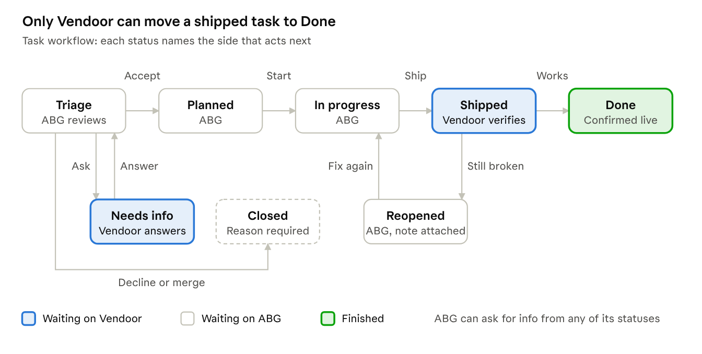
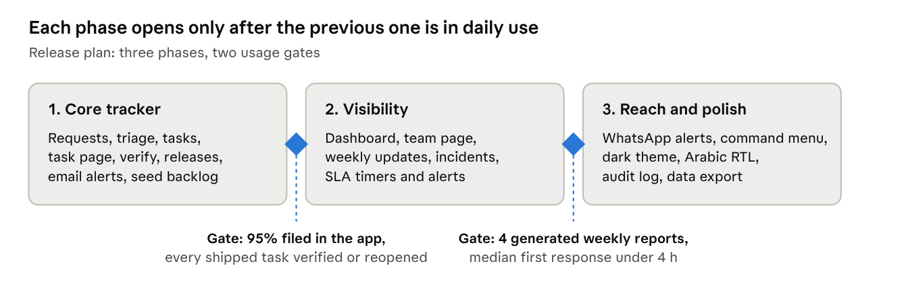

# PRD — Vendoor × ABG Work Tracker

Nov 24, 2026 · @Mosab1

## 1. Overview

We will build a web app where Vendoor files every request to ABG, sees who must act next, and confirms each fix itself. It replaces the "ABG vendoor Cloud team" WhatsApp group as the system of record; WhatsApp stays for urgent pings only. The English version ships first; Arabic (RTL) follows.

### 1.1 Problem

All work with ABG runs through one WhatsApp group. Requests, outages, credentials, questions and weekly reports share one stream, so tasks get buried and nobody can say what ABG is working on or where any item stands.

Evidence from the chat, 27 Sep to 23 Nov 2026 (58 days):

| Signal                             | Value                                           | What it tells us                               |
|------------------------------------|-------------------------------------------------|------------------------------------------------|
| Messages                           | 931 (about 16 a day)                            | One stream is too busy to track work in        |
| Messages from Yara                 | 450 (48%)                                       | Yara is the primary user; design for her first |
| @all mentions                      | 52                                              | Nobody knows who owns the next step            |
| @all with no ABG reply within 12 h | 14 of 51; longest 71 h (8 to 11 Oct)            | No response-time commitment                    |
| "When is the upload?"              | 21                                              | No record of releases and their content        |
| "What's the status?"               | 15                                              | No visible status per task                     |
| Weekly report requested            | 12; 7 reports in 9 weeks, two 14 to 16 day gaps | Reports are written from memory                |
| Days with outage or slowness       | about 11                                        | No incident log or root cause                  |
| Messages holding credentials       | 27                                              | Passwords are shared in plain text             |
| Attachments                        | 72 images, 27 voice notes, 17 videos, 12 files  | Evidence is visual and spoken                  |
| Working days                       | Sunday to Thursday                              | Time limits must count Egyptian working days   |

### 1.2 Root causes

1.  No single place for requests; items fall between messages.

2.  "Done" means four things: coded, tested, deployed, or confirmed by Vendoor. Items reported as done were often not live (7 Oct, 20 Oct, 8 Nov, 22 Nov).

3.  No visible owner of the next step, so @all becomes the only tool.

4.  Weekly reports are free text, not tied to tasks.

5.  The same issue is reported many times as new (Bosta account linking about 6 times, across vara, tamq, scepter, arc).

6.  Decisions change without a record (supplier freeze linked, then unlinked, 9 Nov).

7.  Requests arrive without the order code, account or screenshot; ABG asks for them 15+ times.

8.  Outages close with "it works now" and no cause.

### 1.3 Vision

Every request has one home, one status, one owner of the next step and one confirmation by the person who asked. A dashboard shows what ABG is working on now, what is waiting on Vendoor, and what is late.

## 2. Goals, non-goals and success metrics

Success means Vendoor stops asking "what's the status?" because the answer is always on screen.

### 2.1 Goals

1.  One place for every request from Vendoor to ABG, with the evidence needed to act on it.

2.  A status for every task that says who must act next ("Waiting on").

3.  Nothing counts as done until the requester confirms it works in production.

4.  A dashboard that shows what each ABG member is working on now.

5.  Weekly reporting generated from the data, not written from memory.

6.  A record of every release and every outage, with root cause.

7.  Simple enough that Yara and ABG use it daily without training.

### 2.2 Non-goals (v1)

- Time tracking, billing or invoicing.

- Sprints, cycles, story points or Gantt charts.

- Custom fields or a form builder; fields are fixed.

- Wiki, docs or whiteboards.

- Code, Git or CI integration.

- Storing passwords or credentials of any kind.

- Replacing WhatsApp for chat; it remains for urgent pings.

### 2.3 Success metrics

Measured from the app, first review 8 weeks after launch.

| Metric                                         | Baseline (WhatsApp)                           | Target                      |
|------------------------------------------------|-----------------------------------------------|-----------------------------|
| Requests filed in the app, not WhatsApp        | 0%                                            | 95%                         |
| @all mentions per week in WhatsApp             | about 6                                       | 1 or fewer                  |
| Median first response from ABG (working hours) | not measured; 14 of 51 pings waited over 12 h | Under 4 h; Urgent under 1 h |
| Tasks shipped then reopened                    | not measured                                  | Under 15%                   |
| Weekly update published on time                | 7 of 9 weeks                                  | 100%                        |
| Outages with a recorded root cause             | 0 of about 11                                 | 100%                        |
| Tasks open with no activity for 14+ days       | unknown                                       | 0                           |

## 3. Users, teams and roles

One workspace holds two teams: Vendoor (requests and confirms) and ABG Dev Team (accepts and delivers). ABG is treated as part of the team, with its own members, workload and performance view.

### 3.1 People (from the chat)

| Team    | Person                          | Observed role                                                           | App role             |
|---------|---------------------------------|-------------------------------------------------------------------------|----------------------|
| Vendoor | Yara                            | Operations lead; relays issues from the whole ops team; 48% of messages | Admin                |
| Vendoor | Mohammed Wagih                  | Decision maker; escalates ("Top urgent"); asks for stock sync           | Owner                |
| Vendoor | Mosab Wagih                     | Products, Shopify export                                                | Requester            |
| Vendoor | Abdel-fattah                    | Finance, deposit                                                        | Requester            |
| Vendoor | Eng. Mohamed Adel               | Technical; writes change-request PDFs; DNS                              | Requester            |
| Vendoor | Ops staff (e.g. Noor, Arc team) | Report issues through Yara today                                        | Requester (optional) |
| ABG     | Za8loul                         | Account manager; writes weekly reports                                  | ABG Lead             |
| ABG     | Ahmed Shiha                     | Developer; hands-on fixes                                               | ABG Member           |
| ABG     | Ahmed Kamal Soliman             | Servers, restarts                                                       | ABG Member           |
| ABG     | Other developer                 | Occasional                                                              | ABG Member           |

### 3.2 Personas

- **Yara (primary).** Files most requests, chases status, verifies fixes, needs one screen that says what is waiting on her and what is late. Often on mobile, sends voice notes and videos.

- **Mohammed (owner).** Wants a weekly picture: what shipped, what is at risk, is ABG responsive. Rarely files; escalates.

- **Za8loul (ABG lead).** Triages incoming requests, assigns work, posts the weekly update, records releases.

- **Ahmed (ABG developer).** Sees his assigned tasks, asks for info, moves work to shipped.

### 3.3 Permissions

| Action                                   | Owner | Admin | Requester    | ABG Lead         | ABG Member |
|------------------------------------------|-------|-------|--------------|------------------|------------|
| View all tasks, projects, dashboard      | Yes   | Yes   | Yes          | Yes              | Yes        |
| Create request                           | Yes   | Yes   | Yes          | Yes              | Yes        |
| Accept, decline, merge requests (triage) | No    | No    | No           | Yes              | Yes        |
| Set priority                             | Yes   | Yes   | Suggest only | Yes              | Yes        |
| Set assignee and due date                | No    | No    | No           | Yes              | Yes (self) |
| Move to In progress / Shipped            | No    | No    | No           | Yes              | Yes        |
| Verify (Done) or Reopen                  | Yes   | Yes   | Own requests | No               | No         |
| Cancel a task                            | Yes   | Yes   | Own requests | Propose          | No         |
| Record a release                         | No    | No    | No           | Yes              | Yes        |
| Open / close an incident                 | Yes   | Yes   | Open only    | Yes              | Yes        |
| Write project update                     | Yes   | Yes   | No           | Yes              | No         |
| Manage members, projects, SLA settings   | Yes   | Yes   | No           | ABG members only | No         |

Rules: only the Vendoor side can mark a task Done. Admin and Owner can verify on behalf of any requester.

## 4. Core concepts

Every task has a type, a status that names who acts next, a priority with a time limit, and one project.

### 4.1 Work types

| Type     | Meaning                         | Example from the chat                          |
|----------|---------------------------------|------------------------------------------------|
| Bug      | Something that worked is broken | Bosta exchange orders uploaded with full COD   |
| Change   | Modify existing behaviour       | Thermal label: less margin, bolder text        |
| Feature  | New capability                  | Bosta bulk linking like QP                     |
| Question | How do I...?                    | How to export one account for 18 Jul to 18 Oct |
| Ops      | Admin task for ABG              | Add Facebook TXT record to aff.ven-door.com    |
| Incident | System down or unusable         | "System is down" on 4, 6, 8 Oct; 21, 22 Nov    |

Incidents live in their own log (section 6.11) and can spawn a follow-up Bug.

### 4.2 Workflow and "Waiting on"

Each status belongs to one side. The side that owns the status is shown as **Waiting on** everywhere a task appears.

| Status      | Category  | Waiting on | Who moves it in          | Meaning                                    |
|-------------|-----------|------------|--------------------------|--------------------------------------------|
| Triage      | New       | ABG        | System, on create        | Filed, not reviewed yet                    |
| Needs info  | Blocked   | Vendoor    | ABG                      | ABG asked a question; SLA clock pauses     |
| Planned     | Unstarted | ABG        | ABG (Accept)             | Accepted, has priority, owner and due date |
| In progress | Started   | ABG        | ABG                      | Being built or fixed                       |
| Shipped     | Verify    | Vendoor    | ABG, or a release        | Live in production; requester must test    |
| Reopened    | Started   | ABG        | Vendoor (Still broken)   | Failed verification; needs a note          |
| Done        | Completed | Nobody     | Vendoor (Works)          | Confirmed in production                    |
| Closed      | Canceled  | Nobody     | Either side, with reason | Duplicate, Won't do, or Canceled           |

task workflow · 8 statuses, who acts at each

Work moves left to right on ABG's side; it stops in blue whenever Vendoor must answer or verify.

Rules:

1.  Only Vendoor (requester, Admin or Owner) can move Shipped to Done or Reopened.

2.  Reopened requires a note and accepts attachments; the reopen count is kept on the task.

3.  Shipped tasks not verified in 3 working days get a reminder; after 7 working days they show as "Unverified" on the dashboard (never auto-closed).

4.  Declining or closing requires a reason. Duplicate requires the target task, and moves occurrences and watchers to it.

5.  Optional internal ABG steps (Code review, QA on staging) may be added later as sub-states of In progress; Vendoor still sees "In progress".

### 4.3 Priority and time limits (SLA)

Time counts in working hours, Sunday to Thursday, 10:00 to 18:00 Cairo time (configurable). Time in Needs info does not count against ABG.

| Priority | Use when                                   | First response  | Resolution target |
|----------|--------------------------------------------|-----------------|-------------------|
| Urgent   | System down, orders blocked, money at risk | 1 working hour  | 1 working day     |
| High     | A team cannot do part of its daily work    | 4 working hours | 3 working days    |
| Medium   | Wrong or slow but there is a workaround    | 1 working day   | 7 working days    |
| Low      | Nice to have                               | 2 working days  | None              |

First response = ABG accepts, declines, or asks for info. Resolution target sets the default due date on Accept; ABG may set a later date with a comment. Defaults are editable in Settings.

### 4.4 Projects

A project is a standing area of the Vendoor system. Initial list of 11, taken from the chat:

| Key | Project                       | Examples                                                     |
|-----|-------------------------------|--------------------------------------------------------------|
| BOS | Bosta integration             | Exchange orders, account linking, bulk linking, status notes |
| SHP | Shopify                       | Product export, color and size fields, status mapping        |
| EZO | EasyOrders                    | Status mapping, duplicate webhooks, stock sync               |
| ORD | Orders                        | Order entry, edit order, regions, blacklist, extra phone     |
| DEP | Deposit                       | Deposit dashboard, sheets, label, edits to deposit orders    |
| LBL | Labels and printing           | Thermal label clarity and margins                            |
| ACC | Accounts and permissions      | Who can edit linked accounts, password reset OTP             |
| SUP | Suppliers, products and stock | Stock log, freeze supplier vs products, product page         |
| EXP | Exports and sheets            | Date-range export, supplier name in sheet                    |
| PRF | Performance                   | Welcome page, slow order entry, filters                      |
| INF | Infrastructure and domain     | DNS, server restarts, URL change                             |

Task IDs use the project key and a number, e.g. BOS-14. Projects have a lead (Vendoor), an ABG lead, a health status and weekly updates.

### 4.5 Releases

A release is one deployment to production: number (R-2026-11-22), date, type (Planned or Hotfix), notes and the tasks it contains. Recording a release moves its tasks to Shipped and notifies requesters.

### 4.6 Occurrences

An occurrence is one more report of the same problem: account, order code, date, note, attachment. Users click "Happened again" instead of filing a new task. The count shows on the task and drives priority review.

## 5. Information architecture and navigation

The app has 11 top-level pages in a left sidebar, grouped by how often they are used. Patterns follow Linear and Plane: a short sidebar, list-and-detail layouts, a side panel for tasks.

### 5.1 Sidebar

| Group    | Item                              | Shortcut | Badge                            |
|----------|-----------------------------------|----------|----------------------------------|
| Top      | Workspace switcher: Vendoor × ABG |          |                                  |
| Top      | Search                            | ⌘K       |                                  |
| Top      | New request (primary button)      | C        |                                  |
| Personal | Home                              | G H      |                                  |
| Personal | Inbox                             | G I      | Unread count                     |
| Personal | My work                           | G M      | Items waiting on me              |
| Work     | Requests (triage)                 | G R      | Triage count (ABG)               |
| Work     | Tasks                             | G T      |                                  |
| Work     | Projects                          | G P      |                                  |
| Work     | Team                              |          |                                  |
| Records  | Releases                          |          |                                  |
| Records  | Incidents                         |          | Red dot when an incident is open |
| Records  | Reports (dashboard)               |          |                                  |
| Footer   | Settings, profile, theme, help    |          |                                  |

On mobile the sidebar becomes a bottom bar: Home, Inbox, New, Tasks, More.

### 5.2 URL map

| Page                | URL                                                      |
|---------------------|----------------------------------------------------------|
| Home                | /home                                                    |
| Inbox               | /inbox                                                   |
| My work             | /my-work                                                 |
| Requests            | /requests                                                |
| Tasks (list, board) | /tasks?view=list or board, plus saved filters            |
| Task                | /tasks/BOS-14                                            |
| New request         | /new (also a modal on any page)                          |
| Projects            | /projects                                                |
| Project             | /projects/bos (tabs: overview, tasks, updates)           |
| Team, member        | /team, /team/ahmed-shiha                                 |
| Releases, release   | /releases, /releases/R-2026-11-22                        |
| Incidents, incident | /incidents, /incidents/INC-7                             |
| Reports             | /reports                                                 |
| Settings            | /settings/members, projects, sla, notifications, profile |

### 5.3 Layout patterns

- **List + side panel ("peek").** Clicking a task in any list opens it in a right panel 560 px wide; the list stays visible. Enter or the expand icon opens the full page.

- **Header bar per page.** Title, view switch (List / Board), filter chips, Display menu, primary action.

- **Properties on the right.** Task, project and release pages keep content in the centre and properties in a right column.

- **Same task, same card everywhere.** A task row always shows ID, title, status icon, priority icon, Waiting on, assignee avatar, due date.

## 6. Functional requirements

Each screen lists its purpose, its parts and acceptance criteria (AC). Requirement IDs (FR-x.y) are referenced in testing.

### 6.1 Home

Purpose: in 5 seconds, tell the signed-in person what needs them. Reference: Asana Home, Trello Home.

- **FR-1.1 Greeting line.** "Good morning, Yara" plus one summary sentence: "4 items wait on you · ABG has 12 in progress · 2 overdue".

- **FR-1.2 Waiting on you.** Cards for tasks whose Waiting on = the viewer's side and that involve the viewer (requester, assignee, mentioned). Each card carries its action inline: Vendoor sees **Works / Still broken** on Shipped tasks and **Answer** on Needs info; ABG sees **Accept / Ask / Decline** on Triage.

- **FR-1.3 Overdue.** Tasks past due date or SLA, red date, sorted by most overdue.

- **FR-1.4 Recently shipped.** The last release with verified / pending counts.

- **FR-1.5 Activity.** Last 15 events across the workspace, each a single line.

- **FR-1.6 Open incident banner.** If an incident is open, a red banner at the top with its age and owner.

AC: a Vendoor user with 3 Shipped tasks sees 3 cards with Works / Still broken; clicking Works sets Done without leaving Home; an empty section is hidden, and an all-empty Home shows "You're all caught up".

### 6.2 Inbox

Purpose: personal notifications in one list. Reference: Linear Inbox.

- **FR-2.1** Left list of notifications (newest first), right pane shows the task. Unread dot; Mark read on open.

- **FR-2.2** Events: assigned to me, mentioned, status changed on a task I follow, waiting on me, due tomorrow, overdue, SLA at risk, release recorded, incident opened or closed, project update posted.

- **FR-2.3** Filters: All, Unread, Mentions, Waiting on me. Actions: mark all read, snooze 1 day, unsubscribe from task.

- **FR-2.4** Notifications on the same task within 10 minutes are grouped into one row.

### 6.3 My work

Purpose: the personal task list. Tabs: **Waiting on me**, **Requested by me** (Vendoor) or **Assigned to me** (ABG), **Following**, **Done (last 30 days)**. Grouped by status, same row layout as Tasks.

### 6.4 Requests (triage)

Purpose: ABG reviews every new request before it enters the plan. Reference: Linear Triage, Plain queues.

- **FR-4.1** List of tasks in Triage, oldest first, with age and first-response SLA countdown (amber under 25% left, red when breached).

- **FR-4.2** Actions per row and in the side panel:

  - **Accept**: set priority (prefilled from requester's suggestion), assignee, due date (prefilled from SLA). Moves to Planned.

  - **Ask for info**: required comment. Moves to Needs info; requester is notified.

  - **Decline**: required reason. Moves to Closed (Won't do).

  - **Merge into...**: pick an existing task; this request becomes an occurrence of it and is closed as Duplicate.

- **FR-4.3** A "Possible duplicates" hint shows open tasks in the same project with similar titles.

- **FR-4.4** Vendoor can view Requests read-only to see what has not been picked up.

AC: accepting a request with no due date uses the SLA target; asking for info without text is blocked; a merged request appears in the target's occurrence list with its attachments.

### 6.5 Tasks

Purpose: the full list of work, filterable and switchable between List and Board. Reference: Linear list and Display menu, Plane board, Jira board.

- **FR-5.1 List view.** Rows grouped by status (default), project, priority, assignee or Waiting on. Columns: ID, title, project, status, priority, Waiting on, assignee, requester, due, updated. Collapsible groups with counts.

- **FR-5.2 Board view.** Columns = statuses (Closed hidden by default). Cards show ID, title, priority, assignee, due, occurrence count, attachment icon. Drag between columns obeys permissions (e.g. a Vendoor user cannot drag into In progress); an invalid drop snaps back with a toast.

- **FR-5.3 Filters.** Chips for project, status, type, priority, assignee, requester, Waiting on, due (overdue, this week), created date, has occurrences. Text search on title and description.

- **FR-5.4 Display menu.** Grouping, ordering (priority, due, updated, created), show Closed, show sub-tasks, visible properties. "Save as view" stores filters + display.

- **FR-5.5 Default views.** All open; Waiting on Vendoor; Waiting on ABG; Overdue; Urgent and High; Bugs; Shipped, not verified; Done this week.

- **FR-5.6 Bulk actions.** Select rows, then change priority, assignee, project, due date, or close (ABG); verify (Vendoor, Shipped only).

- **FR-5.7 Inline edit.** Status, priority, assignee, due editable from the row by click or keyboard, within permissions.

- **FR-5.8 Export.** Current view to CSV.

AC: a list of 1,000 tasks renders in under 1 s; filters persist in the URL so a view can be shared by link.

### 6.6 Task page

Purpose: everything about one piece of work, and the next action for whoever must act. Reference: Linear issue, Jira work item, Asana approval.

Layout: breadcrumb (Project › ID), title, action bar, main column, right properties column, activity at the bottom.

- **FR-6.1 Action bar** changes with status and viewer:

  - Shipped, viewer is Vendoor: **Works** (to Done) and **Still broken** (to Reopened, opens a note box with attachment).

  - Needs info, viewer is Vendoor: **Answer** (comment moves it back to the previous ABG status).

  - Triage, viewer is ABG: Accept / Ask for info / Decline / Merge.

  - Planned or Reopened, viewer is ABG: Start; In progress: Mark shipped (optionally pick a release).

- **FR-6.2 Description.** Rich text: headings, lists, links, inline images, code. Editable by requester and ABG; edits are versioned in History.

- **FR-6.3 Pinned decision.** One highlighted block above the description ("Exchange orders use shipping value only"). Changing it logs old and new text with author and date.

- **FR-6.4 Sub-tasks.** Checklist-style child tasks with their own status and assignee; progress bar (2 / 3). Used to split change-request PDFs into points.

- **FR-6.5 Occurrences ("Happened again").** Button opens a mini form: account, order code(s), date, note, attachment. List shows newest first with count in the header.

- **FR-6.6 Attachments.** Images, video (mp4, mov), audio (opus, m4a, mp3, including WhatsApp voice notes), PDF, xlsx, csv; up to 100 MB each; inline preview and audio player; paste from clipboard; drag and drop.

- **FR-6.7 Relations.** Related to, Blocks / Blocked by, Duplicate of; shown as chips with status.

- **FR-6.8 Properties column.** Status, Waiting on (read-only), Priority, Type, Project, Requester, Assignee, Due date with SLA indicator, Release, Accounts affected (free tags, e.g. tamqve@outlook.com, ve7586), Order codes (tags), Reopen count, Created, Updated, Followers.

- **FR-6.9 Activity.** Tabs: All, Comments, History. Comments support mentions, attachments, emoji reactions, edit within 15 minutes, internal note (ABG only, hidden from Vendoor) as an option.

- **FR-6.10 Quick replies.** Chips above the comment box: "Any update?" (sends a status request to the assignee and logs it), "Need more info" (ABG), "Tested, works" / "Still broken" (Vendoor).

- **FR-6.11 Credential guard.** If a comment or description matches password-like patterns ("password", "باسورد", pass:, a line after an email address), show a warning before saving: "Don't paste passwords here. Share them in person or through a password manager." User may edit or post anyway; the event is logged.

- **FR-6.12 Follow.** Requester, assignee and commenters follow automatically; anyone can follow or unfollow.

AC: a Vendoor requester clicking Still broken without a note cannot submit; a Shipped task verified as Works shows Done with the verifier's name and time; the reopen count increments on each Reopen.

### 6.7 New request

Purpose: capture a complete request in under 90 seconds, so ABG never has to ask for basics. Reference: Supabase support form, Luma report, Jira and ClickUp forms.

Opens as a modal from anywhere (C) or full page on mobile. Three steps on one screen, revealed progressively:

1.  **What kind?** Bug, Change, Feature, Question, plus a separate red button **System is down** that opens an incident instead.

2.  **Where?** Project, then a quick-pick category for that project (e.g. Bosta: Exchange orders, Account linking, Status notes, Bulk linking, Other).

3.  **Details** by type:

| Field                           | Bug                       | Change   | Feature  | Question |
|---------------------------------|---------------------------|----------|----------|----------|
| Title                           | Required                  | Required | Required | Required |
| What happens now                | Required                  | Required | Optional | Optional |
| What should happen              | Required                  | Required | Required | Optional |
| Account(s) affected             | Required                  | Optional | Optional | Optional |
| Order code(s)                   | Required if order-related | Optional | No       | Optional |
| Screenshot, video or voice note | At least one              | Optional | Optional | Optional |
| How often                       | Once / Sometimes / Always | No       | No       | No       |
| Suggested priority              | Required                  | Required | Required | No       |
| Why it matters                  | Optional                  | Required | Required | No       |

- **FR-7.1** Voice note recording in the browser (up to 5 minutes) and file upload from the phone gallery.

- **FR-7.2** Possible duplicates are listed as the title is typed; picking one adds an occurrence instead of a new task.

- **FR-7.3** Credential guard (FR-6.11) applies to every text field.

- **FR-7.4** Draft is saved locally if the modal closes.

- **FR-7.5** After submit: toast with the task ID and link; the task starts in Triage.

- **FR-7.6** Attach a change-request PDF and split it into sub-tasks (one per numbered point, entered manually in v1).

### 6.8 Projects and project page

Reference: Height projects table, Linear project overview and updates, Basecamp "How far along are we?".

- **FR-8.1 Projects list.** Table: name, health (On track / At risk / Off track), Vendoor lead, ABG lead, open tasks, overdue, progress (done / total in the last 90 days), last update date. A project without an update for 8+ days shows "Update due".

- **FR-8.2 Project page tabs.** Overview (description, properties, latest update, open tasks by status, recent activity), Tasks (same views as 6.5, pre-filtered), Updates (history).

- **FR-8.3 Project update.** ABG lead posts weekly: health, what shipped, what is in progress, what is blocked and on whom, next week. The editor is pre-filled from data (tasks moved to Shipped or Done this week, In progress, Needs info, overdue); the lead edits and posts. Followers and Owner are notified.

- **FR-8.4 Weekly digest.** Every Sunday 10:00 the app composes all project updates into one Weekly report page (and email) for the Owner. This replaces the WhatsApp weekly report.

### 6.9 Team

Purpose: what each person is working on, both teams side by side. Reference: ClickUp Team view, Front workload.

- **FR-9.1 Member cards.** Avatar, name, team, role; In progress (titles listed), Planned count, Shipped this week, Overdue, average first response (ABG) or average verify time (Vendoor), last active.

- **FR-9.2 Member page.** Their tasks by status and their activity feed for the last 30 days.

- **FR-9.3** Filter: ABG only, Vendoor only, All.

### 6.10 Reports (dashboard)

Purpose: answer "what is the team working on, and is it healthy?" in one screen. Reference: Asana dashboard cards, Front workload metrics, Linear progress, incident.io calendar.

Date range control at the top (this week, last 4 weeks, last 12 weeks, custom). Every number links to the task list behind it.

- **FR-10.1 KPI row.** Open tasks; In progress; Waiting on Vendoor; Waiting on ABG; Overdue; Shipped, not verified; Median first response (h); Reopen rate (%); Downtime this month (h).

- **FR-10.2 Now working on.** One lane per ABG member, listing their In progress tasks with project, priority and days in status.

- **FR-10.3 Waiting on balance.** Horizontal bar: open tasks waiting on ABG vs Vendoor, and the oldest item on each side.

- **FR-10.4 Throughput.** Weekly created vs done for the last 12 weeks.

- **FR-10.5 Project health.** Each project with its health dot, open count and overdue count.

- **FR-10.6 Aging.** Open tasks by age bucket (0 to 3 days, 4 to 7, 8 to 14, 15 to 30, 30+), split by Waiting on.

- **FR-10.7 SLA.** Share of tasks meeting first-response and resolution targets, by priority.

- **FR-10.8 Incidents.** Month calendar with incident days marked and total downtime.

- **FR-10.9 Export.** The dashboard as PDF, and each widget's data as CSV.

AC: every KPI matches the count of the linked list exactly; dashboard loads in under 2 s with 5,000 tasks.

### 6.11 Releases

Reference: Gumloop and Canny changelogs, Sentry release page.

- **FR-11.1 List.** Newest first: number, date, type (Planned, Hotfix), task count, verified / pending / reopened counts.

- **FR-11.2 Record a release (ABG).** Number auto-filled (R-YYYY-MM-DD, suffix -2 for a second that day), date and time, notes, pick tasks (In progress or Shipped). Saving moves picked tasks to Shipped and notifies their requesters: "BOS-14 is live. Please test."

- **FR-11.3 Release page.** Notes and the task list with verification state per task; tasks reopened after this release are flagged "Regressed".

- **FR-11.4 Upcoming release.** ABG may create a planned release with a target date; it shows on Home for Vendoor as "Next release: Thu 26 Nov, 6 tasks".

### 6.12 Incidents

Reference: incident.io status page and incident detail.

- **FR-12.1 Open.** Any user via "System is down": what is affected (whole system, a page, a role), started at (default now), screenshot. Creates INC-n, notifies ABG by email and WhatsApp (when enabled) at once.

- **FR-12.2 States.** Investigating, Identified, Monitoring, Resolved. Each change posts a timeline entry.

- **FR-12.3 Close.** Requires resolved-at time, impact, root cause, and a follow-up (a linked task or "none needed" with reason).

- **FR-12.4 List and calendar.** Month calendar with incident days, list with duration and cause; a "Closed without cause" filter must be empty.

### 6.13 Search and command menu

- **FR-13.1** ⌘K opens a menu: search tasks (ID, title, description, comments, order codes, accounts), projects, people, releases; and actions (New request, Go to..., Assign to me, Change status).

- **FR-13.2** Typing an order code like si1267 or an account email finds every task and occurrence that mentions it.

### 6.14 Settings

- **FR-14.1 Members.** Invite by email, role (section 3.3), team, deactivate. Pending invitations with resend.

- **FR-14.2 Projects.** Create, rename, archive; key; Vendoor lead and ABG lead; quick-pick categories for New request.

- **FR-14.3 SLA and calendar.** Priority targets, working days, working hours, holidays.

- **FR-14.4 Notifications.** Per user: email on/off per event, daily digest time, WhatsApp on/off (phase 3).

- **FR-14.5 Profile.** Name, avatar, language (English now, Arabic later), theme (Light, Dark, System).

- **FR-14.6 Audit log.** Owner and Admin can see sign-ins, role changes, deletions and credential-guard overrides.

## 7. Notifications

The app notifies the person who must act, not everyone. In-app and email ship in phase 1; WhatsApp ships in phase 3 as a one-way alert with a link back to the task.

| Event                                | Who                       | In-app | Email            | WhatsApp (phase 3) |
|--------------------------------------|---------------------------|--------|------------------|--------------------|
| New request in Triage                | ABG Lead, ABG Members     | Yes    | Digest every 2 h | Urgent only        |
| Accepted, with due date              | Requester                 | Yes    | Yes              | No                 |
| Needs info                           | Requester                 | Yes    | Yes              | Yes                |
| Shipped (single or via release)      | Requester, followers      | Yes    | Yes              | Yes                |
| Reopened                             | Assignee, ABG Lead        | Yes    | Yes              | Yes                |
| Done                                 | Assignee, followers       | Yes    | No               | No                 |
| Mentioned in a comment               | Mentioned person          | Yes    | Yes              | No                 |
| New comment on a followed task       | Followers                 | Yes    | Daily digest     | No                 |
| "Any update?" request                | Assignee                  | Yes    | Yes              | Yes                |
| SLA at risk (25% left)               | Assignee, ABG Lead        | Yes    | Yes              | Urgent and High    |
| SLA breached                         | Assignee, ABG Lead, Admin | Yes    | Yes              | Yes                |
| Shipped, not verified 3 working days | Requester                 | Yes    | Yes              | No                 |
| Incident opened                      | Everyone                  | Yes    | Yes              | Yes                |
| Incident resolved                    | Everyone                  | Yes    | Yes              | Yes                |
| Project update due (8 days)          | ABG Lead                  | Yes    | Yes              | No                 |
| Weekly report published              | Owner, Admin              | Yes    | Yes              | Link               |

Rules:

1.  One notification per task per 10 minutes per person; later events are grouped.

2.  Users never get notified of their own actions.

3.  Daily digest at 09:30 Cairo: waiting on me, overdue, due today.

4.  Emails are plain, single-action: subject = "\[BOS-14\] Shipped: please test", body = one line + button.

5.  WhatsApp alerts go to a dedicated number through the WhatsApp Business API; replies are not read in v1.

## 8. Data model

Fifteen entities cover v1. All have id (UUID), created_at, updated_at; deletes are soft (archived_at).

| Entity        | Key fields                                                                                                                                                                                                                                                                                                                                                | Relations                                                   |
|---------------|-----------------------------------------------------------------------------------------------------------------------------------------------------------------------------------------------------------------------------------------------------------------------------------------------------------------------------------------------------------|-------------------------------------------------------------|
| Workspace     | name, timezone (Africa/Cairo), working_days, working_hours                                                                                                                                                                                                                                                                                                | has Teams, Projects                                         |
| Team          | name (Vendoor, ABG), side (requester / delivery)                                                                                                                                                                                                                                                                                                          | has Members                                                 |
| Member        | name, email, avatar, role (owner, admin, requester, abg_lead, abg_member), status, last_active_at, notification_prefs                                                                                                                                                                                                                                     | belongs to Team                                             |
| Project       | key (BOS), name, description, health (on_track, at_risk, off_track), vendoor_lead_id, abg_lead_id, categories\[\]                                                                                                                                                                                                                                         | has Tasks, ProjectUpdates                                   |
| Task          | number, key (BOS-14), title, description, type, status, priority, suggested_priority, project_id, category, requester_id, assignee_id, due_at, sla_first_response_due_at, sla_resolution_due_at, first_response_at, shipped_at, verified_at, verified_by, reopen_count, parent_id, release_id, decision_text, accounts\[\], order_codes\[\], close_reason | has Comments, Attachments, Occurrences, Relations, Activity |
| Occurrence    | task_id, reported_by, account, order_codes\[\], happened_at, note                                                                                                                                                                                                                                                                                         | has Attachments                                             |
| Comment       | task_id, author_id, body, is_internal, edited_at                                                                                                                                                                                                                                                                                                          | has Attachments, Reactions                                  |
| Attachment    | owner_type, owner_id, file_url, mime, size, duration (audio, video), thumbnail_url                                                                                                                                                                                                                                                                        |                                                             |
| Relation      | from_task_id, to_task_id, kind (related, blocks, duplicate_of)                                                                                                                                                                                                                                                                                            |                                                             |
| Release       | number, released_at, type (planned, hotfix), notes, created_by                                                                                                                                                                                                                                                                                            | has Tasks                                                   |
| Incident      | number, title, scope, state, started_at, resolved_at, impact, root_cause, follow_up_task_id, opened_by                                                                                                                                                                                                                                                    | has TimelineEntries                                         |
| ProjectUpdate | project_id, author_id, health, body, period_start, period_end                                                                                                                                                                                                                                                                                             |                                                             |
| ActivityEvent | actor_id, subject_type, subject_id, verb (created, status_changed, field_changed, commented, verified, reopened...), from, to, at                                                                                                                                                                                                                         | feeds History, Inbox, Reports                               |
| Notification  | member_id, event_id, read_at, snoozed_until, channel                                                                                                                                                                                                                                                                                                      |                                                             |
| SavedView     | owner_id or shared, name, filters, display                                                                                                                                                                                                                                                                                                                |                                                             |

Derived fields (computed, not stored by users): waiting_on (from status), is_overdue, sla_state (ok, at_risk, breached, paused), age_in_status, occurrence_count.

SLA clock: paused while status = Needs info; counts only working hours; first response is the first of Accept, Ask for info, Decline or an ABG comment.

## 9. Design system

Calm, dense and readable, in the Linear and Plane tradition: a light neutral canvas, colour only where it carries meaning, one accent. Light theme first; dark theme built from the same tokens. Colour values are placeholders until Vendoor's brand colours are confirmed.

### 9.1 Typography

- **UI font:** Inter (open licence), variable, with tabular numbers for counts and dates. Alternative: Geist.

- **Mono:** JetBrains Mono for task IDs, order codes, account emails and release numbers.

- **Arabic (phase 3):** IBM Plex Sans Arabic, same sizes, line height +10%.

| Token   | Size / line height | Weight   | Use                        |
|---------|--------------------|----------|----------------------------|
| display | 24 / 32            | 600      | Page titles, Home greeting |
| title   | 20 / 28            | 600      | Task title                 |
| heading | 16 / 24            | 600      | Section headings           |
| body    | 14 / 22            | 400      | Descriptions, comments     |
| ui      | 13 / 20            | 400, 500 | Lists, menus, buttons      |
| meta    | 12 / 16            | 400      | Timestamps, helper text    |
| kpi     | 28 / 32            | 600      | Dashboard numbers          |

### 9.2 Colour tokens

| Token          | Light    | Dark     | Use                               |
|----------------|----------|----------|-----------------------------------|
| bg.canvas      | \#FAFAFB | \#0F1013 | Page background                   |
| bg.surface     | \#FFFFFF | \#16181D | Cards, panels, modals             |
| bg.subtle      | \#F3F4F6 | \#1D2026 | Hover, sidebar, table header      |
| border.default | \#E5E7EB | \#2A2E36 | Dividers, inputs                  |
| text.primary   | \#111318 | \#EDEEF0 | Main text                         |
| text.secondary | \#5B6170 | \#A0A6B1 | Labels, meta                      |
| text.muted     | \#8B909B | \#6E7480 | Placeholders, disabled            |
| action.primary | \#111318 | \#EDEEF0 | Primary buttons                   |
| accent         | \#4F5BD5 | \#7C86F0 | Links, focus ring, selection      |
| waiting.you    | \#0A84FF | \#3B9BFF | "Waiting on you" badges and cards |

| Status      | Colour   | Icon                                    |
|-------------|----------|-----------------------------------------|
| Triage      | \#8E4EC6 | Dashed circle                           |
| Needs info  | \#0A84FF | Circle with question mark               |
| Planned     | \#8B8D98 | Empty circle                            |
| In progress | \#E5A000 | Half-filled circle                      |
| Shipped     | \#0A84FF | Three-quarter circle                    |
| Reopened    | \#E5484D | Circular arrow                          |
| Done        | \#30A46C | Filled circle with check                |
| Closed      | \#B9BBC6 | Circle with slash; title struck through |

| Priority | Colour   | Icon                 |
|----------|----------|----------------------|
| Urgent   | \#E5484D | Filled square with ! |
| High     | \#F76B15 | 3 bars               |
| Medium   | \#E5A000 | 2 bars               |
| Low      | \#8B8D98 | 1 bar                |

Health: On track \#30A46C, At risk \#E5A000, Off track \#E5484D. Colour is never the only signal: every status and priority has an icon and a label. All text meets WCAG AA contrast (4.5:1).

### 9.3 Spacing, shape, elevation

- 4 px grid; common steps 4, 8, 12, 16, 24, 32.

- Radius: 6 px controls, 8 px cards, 12 px modals; avatars round.

- List row height 36 px (compact 32 px option); board card min height 72 px.

- Sidebar 240 px (collapsible to 56 px); task side panel 560 px; content max width 1200 px.

- Borders 1 px; shadows only on popovers and modals (0 8px 24px rgba(0,0,0,0.12)).

- Icons: Lucide, 16 px in lists, 1.5 px stroke.

### 9.4 Components

Button (primary, secondary, ghost, danger; sm 28 px, md 32 px), Input, Textarea, Select, Combobox with search, Property chip (status, priority, assignee, date), Avatar and avatar group, Badge (Waiting on, SLA), Tabs, Segmented control (List / Board), Filter chip, Dropdown menu, Command menu, Modal, Side panel, Toast with Undo, Tooltip, Table, Kanban column and card, Empty state, Skeleton loader, Date picker, File drop zone, Audio player, Video thumbnail, KPI card, Bar and line chart, Calendar heatmap, Banner (incident).

### 9.5 Interaction principles

1.  Every action within two clicks of where the task appears (verify from Home, accept from Requests).

2.  Inline editing everywhere; no separate edit screens.

3.  Optimistic updates with Undo for 5 seconds on status changes and closes.

4.  Keyboard first for ABG: C new, / or ⌘K search, J / K move, E edit, A assign, S status, P priority, V verify, Esc close panel.

5.  Empty states say one sentence and offer one button ("No requests waiting. Nice.").

6.  Skeletons, not spinners, for loads over 300 ms.

7.  Relative dates ("2 days ago") with exact time on hover; due dates absolute ("Thu 26 Nov").

8.  Mobile: Home, Inbox, Task, New request and verify are fully usable at 375 px; voice and video capture work from the phone.

9.  Layout uses logical CSS properties (start / end, not left / right) so the Arabic RTL version needs no rework.

## 10. Non-functional requirements

The tracker must stay fast and available on the days the Vendoor system itself is down, so it runs on separate infrastructure.

| Area                 | Requirement                                                                                                                                    |
|----------------------|------------------------------------------------------------------------------------------------------------------------------------------------|
| Hosting              | Separate from the Vendoor production servers (different host and database), so incidents can be filed while Vendoor is down                    |
| Availability         | 99.5% monthly; daily database backups kept 30 days; restore tested monthly                                                                     |
| Performance          | First load under 2 s on 4G; navigation between pages under 300 ms; lists of 1,000 tasks render under 1 s; search results under 500 ms          |
| Real time            | Status, comments and new tasks appear for other viewers within 5 s without reload                                                              |
| Authentication       | Email + password with optional magic link (decision pending); sessions 30 days; 2FA optional for Owner and Admin                               |
| Authorisation        | Enforced on the server for every action in section 3.3, not only hidden in the UI                                                              |
| Security             | HTTPS only; files in private storage with signed URLs that expire in 1 h; no credential fields anywhere; credential guard (FR-6.11); audit log |
| Privacy              | Customer phone numbers and names may appear in screenshots; access limited to workspace members; no public links in v1                         |
| Files                | Up to 100 MB per file, 5 GB total to start; images compressed for previews; audio and video playable in the browser                            |
| Accessibility        | WCAG 2.1 AA: contrast, focus rings, full keyboard use, labels on icon buttons, screen-reader names for status icons                            |
| Browsers and devices | Latest Chrome, Safari, Edge, Firefox; iOS Safari and Android Chrome; responsive from 375 px                                                    |
| Localisation         | English first; all strings in translation files; dates in Africa/Cairo; RTL-ready layout for Arabic                                            |
| Time                 | Working-day calendar (Sunday to Thursday) and holidays configurable; all SLA maths uses it                                                     |
| Observability        | Error tracking and uptime monitoring on the tracker itself                                                                                     |
| Data export          | Owner can export all tasks, comments and attachments metadata as CSV or JSON at any time                                                       |

## 11. Migration from WhatsApp and rollout rules

At launch the app is seeded with every item still open or unconfirmed in the chat, so day one starts from a true backlog, not an empty board.

### 11.1 Seed backlog

Each row becomes a task with its first-reported date, the chat examples as occurrences, and screenshots re-attached where available. "Verify" rows start as Shipped so Vendoor confirms them; all others start in Triage for ABG to accept with a date.

| Project  | Item                                                                                           | Type     | First reported | Last mentioned | Start as                          |
|----------|------------------------------------------------------------------------------------------------|----------|----------------|----------------|-----------------------------------|
| LBL      | Thermal label unclear: large empty margins, small text                                         | Change   | 15 Oct         | 21 Nov         | Triage                            |
| BOS      | Bosta account linking fails intermittently (vara, tamq, scepter, arc)                          | Bug      | 11 Oct         | 22 Nov         | Triage                            |
| BOS      | Status notes must stop at final status (Delivered, Returned)                                   | Bug      | 24 Oct         | 22 Nov         | Reopened                          |
| BOS      | Refused returns get a status that does not exist in Bosta (oe5942, 364 orders)                 | Bug      | 25 Oct         | 25 Oct         | Triage                            |
| BOS      | Order marked Delivered but Bosta shows cancelled (tb2147)                                      | Bug      | 20 Oct         | 21 Oct         | Triage                            |
| ORD      | Outside exchange orders show as New (Zd8781)                                                   | Bug      | 31 Oct         | 1 Nov          | Triage                            |
| DEP      | Deposit orders: edits blocked, deposit cannot be reduced, status stuck in processing (CR M-03) | Bug      | 15 Nov         | 22 Nov         | Triage                            |
| PRF      | Order entry takes 2 to 3 minutes; all pages slow                                               | Bug      | 22 Nov         | 23 Nov         | Triage (Urgent)                   |
| PRF      | Search filter slow; show more than 5 filters; best-products page heavy                         | Change   | 18 Nov         | 18 Nov         | Triage                            |
| PRF      | Dashboard numbers visible without the eye icon for suppliers and staff                         | Change   | 18 Nov         | 19 Nov         | Needs info (Yara to decide)       |
| SUP      | Stock history in supplier account lacks quantity added or removed and time                     | Bug      | 19 Nov         | 19 Nov         | Triage                            |
| SUP      | Product page: full product name and colour names cut off                                       | Change   | 18 Nov         | 18 Nov         | Triage                            |
| SUP      | Closed product still visible to marketers                                                      | Bug      | 28 Oct         | 28 Oct         | Triage                            |
| SUP      | Product activation separated from supplier activation                                          | Change   | 9 Nov          | 22 Nov         | Shipped (verify)                  |
| EZO      | Orders from marketer ads not syncing to Vendoor (27552)                                        | Bug      | 19 Nov         | 19 Nov         | Triage                            |
| EZO      | Marketer orders land in Problems page (ve21427)                                                | Bug      | 15 Nov         | 15 Nov         | Triage                            |
| EZO      | Deleting in Vendoor should delete in EasyOrders; block duplicate orders (Rt8584, Ka8316)       | Feature  | 6 Oct          | 6 Oct          | Triage                            |
| EZO, SHP | Real-time stock sync to EasyOrders and Shopify after export                                    | Feature  | 28 Sep         | 1 Nov          | Needs info (confirm how it works) |
| SHP      | Export colour and size as separate options                                                     | Change   | 31 Oct         | 1 Nov          | Triage                            |
| SHP      | Easy export of all products to EasyOrders and Shopify                                          | Feature  | 28 Oct         | 28 Oct         | Triage                            |
| ORD      | Edit button on orders does not open (Arc)                                                      | Bug      | 16 Nov         | 17 Nov         | Triage                            |
| ORD      | Extra customer phone not accepted (ok8906)                                                     | Bug      | 15 Nov         | 15 Nov         | Triage                            |
| ORD      | New Valley missing from region search for new orders                                           | Bug      | 8 Nov          | 8 Nov          | Triage                            |
| ORD      | Blacklist: staff can edit only to cancel                                                       | Change   | 31 Oct         | 31 Oct         | Triage                            |
| ACC      | Account ve5372 will not open                                                                   | Bug      | 23 Nov         | 23 Nov         | Triage (High)                     |
| ACC      | Forgot-password code not sent (OTP service)                                                    | Bug      | 13 Oct         | 14 Oct         | Triage                            |
| INF      | Facebook domain verification tag on aff.ven-door.com                                           | Ops      | 28 Oct         | 9 Nov          | Shipped (verify)                  |
| INF      | Action logged 3 times in the system                                                            | Bug      | 29 Oct         | 29 Oct         | Triage                            |
| INF      | Root cause for outages on 21 and 22 Nov                                                        | Incident | 21 Nov         | 22 Nov         | Incident, closed without cause    |

### 11.2 Rollout rules (agreed with ABG before launch)

1.  From launch day, a request counts only if it exists in the app. ABG replies in WhatsApp with the task link, not with a fix.

2.  WhatsApp group is for "System is down" pings and links only.

3.  Only Vendoor marks a task Done.

4.  ABG posts project updates every Sunday; the weekly report is generated from them.

5.  No passwords in the app or the group; credentials move to a password manager. Passwords already shared in the chat (27 messages) should be changed.

6.  First 2 weeks: Yara may file on behalf of the ops team; after that each requester files their own.

### 11.3 Launch steps

1.  Seed projects, members and the backlog above.

2.  30-minute walkthrough for each side (Vendoor: file, verify; ABG: triage, ship, release, update).

3.  Pin the app link in the WhatsApp group description.

4.  Review after week 1 and week 4 against section 2.3.

## 12. Release plan and open questions

Three phases, each gated on real use, not on a date. Durations are to be estimated with whoever builds it.

release plan · 3 phases, 2 gates

Phase 2 starts only when the tracker has replaced WhatsApp for requests; phase 3 only when reporting runs from the data.

### 12.1 Phase 1: Core tracker (MVP)

Goal: every request lives in the app and Vendoor confirms every fix.

- Sign-in, members, roles, projects (3.3, 6.14)

- New request with typed fields, attachments, voice notes, credential guard (6.7)

- Requests triage: accept, ask, decline, merge (6.4)

- Tasks list and board, filters, saved views (6.5)

- Task page with verify / reopen, decision, sub-tasks, occurrences, activity (6.6)

- Home and My work (6.1, 6.3)

- Releases (6.11)

- In-app and email notifications (7)

- Seed backlog (11.1)

Exit gate: 2 weeks with 95% of requests filed in the app and every shipped task verified or reopened by Vendoor.

### 12.2 Phase 2: Visibility

Goal: anyone can see what ABG is working on and whether it is healthy.

- Reports dashboard (6.10)

- Team page (6.9)

- Project updates and the generated weekly report (6.8)

- Incidents with root cause (6.12)

- SLA timers, at-risk and breach alerts (4.3, 7)

- Inbox grouping, daily digest (6.2, 7)

Exit gate: 4 consecutive weekly reports generated from the app; median first response measured and under 4 working hours.

### 12.3 Phase 3: Reach and polish

- WhatsApp alerts through the Business API (7)

- Command menu and full keyboard shortcuts (6.13, 9.5)

- Dark theme

- Arabic UI with RTL

- Audit log and data export (6.14, 10)

### 12.4 Open questions

- [ ] Does Vendoor have a logo and brand colours to replace the placeholder accent?

- [ ] Which ABG members will use the app daily? Is Za8loul the single triage owner?

- [ ] Sign-in method: email + password, magic link, or both?

- [ ] Who builds the tracker: ABG, another team, or a ready-made tool configured to this spec?

- [ ] Working hours for SLA: confirm 10:00 to 18:00, Sunday to Thursday, and the holiday list.

- [ ] Should Vendoor ops staff (beyond the five named requesters) get their own accounts at launch?

- [ ] WhatsApp Business number for alerts: existing number or a new one?

- [ ] Retention: keep attachments indefinitely, or archive after 12 months?
